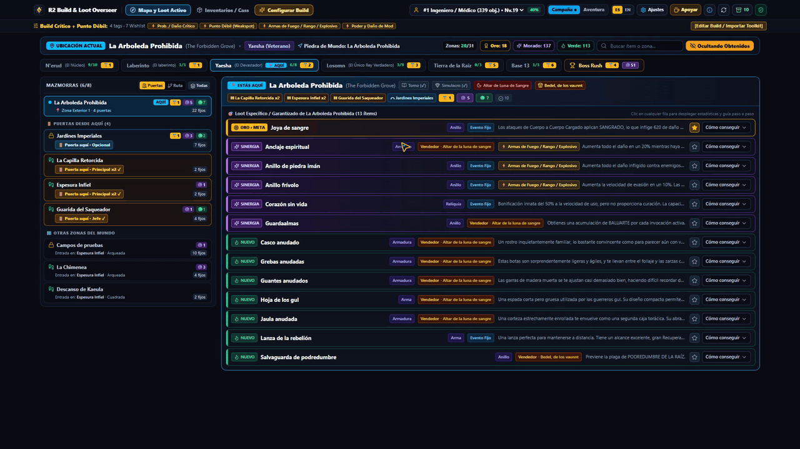

#  Remnant 2 Build & Loot Overseer (v1.0)

**Aplicación de escritorio independiente (100% Lectura Segura / Cero Escritura)** para analizar en tiempo real tus mundos generados de *Remnant II*, priorizar el botín pendiente según las sinergias y Wishlist de tu **Build**, explorar **conectividad física de puertas**, y consultar el pool global de **Boss Rush** en **Español e Inglés (`ES | EN`)**.

Distribuido gratuitamente bajo licencia **GNU GPL-3.0**.
- **Desarrollado por:** `Choppx`
- **Apoyar el proyecto:** [https://ko-fi.com/choppx](https://ko-fi.com/choppx)

<p align="center">
  
</p>

---

## Características Principales (v1.0)
- **Priorización Inteligente de Loot por Build (`Oro` / `Morado` / `Verde` / `Gris`):** Cruza tu `profile.sav` y `save_*.sav` contra etiquetas mecánicas e importación directa de URLs/listas de *Remnant 2 Toolkit*.
- **Grafo Real de Conectividad de Puertas (UE5 `ZoneActor` + `ZoneLinks`):** Identifica puertas caminables desde tu ubicación actual (`🚪 Puerta aquí · Principal` cuadrada vs `🚪 Puerta aquí · Opcional` arqueada, `↩ Conectada / Salida`, y ruta completa del mundo).
- **Nodo Global `Boss Rush`:** Filtra todos los World Drops globales y armas/mods/prismas elegibles por rachas de Boss Rush cruzados contra tu `profile.sav`.
- **Selector Instantáneo `ES | EN`:** Cambia en tiempo real toda la interfaz, nombres de zonas/objetos, descripciones y guías paso a paso sin reiniciar.
- **Soporte Multi-Plataforma (`Steam`, `Epic Games`, `Xbox / PC Game Pass`):** Detección automática y manual de subcarpetas de ID y contenedores UWP `containers.index` (`SystemAppData\wgs`).
- **Seguridad Estricta Cero Escritura (`SaveGuardValidator`):** Jamás escribe ni bloquea la carpeta del juego. Opera sobre copias temporales en RAM/temp (`<15 ms`, debounce `650 ms`) con hasta 10 respaldos preventivos `.zip` rotativos.

---

## Compilar Paquete Portable "Listo para Usar" (`build-release`)
Para generar la carpeta limpia auto-contenida (`win-x64`, sin requerir que el usuario instale .NET ni Node.js) y su archivo `.zip` listo para subir a **GitHub Releases** o **Nexus Mods**:

```powershell
.\build-release.ps1
```
*(O haz doble clic en `build-release.bat`).*

El paquete portable se generará en:
- `release\Remnant2-BuildLootOverseer-v1.0.0-win-x64\`
- `release\Remnant2-BuildLootOverseer-v1.0.0-win-x64.zip`


---

## Créditos y Proyectos Base
- **[Angelore/RemnantOverseer](https://github.com/Angelore/remnant-two-overseer)** & **`lib.remnant2.analyzer` / `lib.remnant2.saves`** — Motor de desencriptado y análisis de archivos `.sav` de Unreal Engine 5.
- **[joshpayette/remnant2-toolkit](https://github.com/joshpayette/remnant2-toolkit)** — Base de datos comunitaria de ítems, estadísticas, etiquetas de sinergia y ecosistema de builds.

---

## Licencia y Aviso Legal
- **Licencia:** Distribuido bajo **GNU General Public License v3.0 (GPL-3.0)** (ver [LICENSE](LICENSE) y [THIRD_PARTY_NOTICES.md](THIRD_PARTY_NOTICES.md)).
- **Aviso Legal (ES):** *Herramienta fan no oficial y gratuita. No afiliada, asociada ni respaldada por Gunfire Games ni Arc Games.*
- **Legal Notice (EN):** *Free, unofficial fan-made tool. Not affiliated with, associated with, or endorsed by Gunfire Games or Arc Games.*
